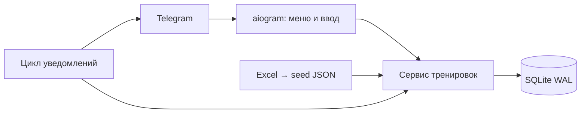

# Telegram-бот для тренировок

**Linux / CasaOS / Docker:** пошаговый запуск, обновление и резервное копирование описаны в [CASAOS.md](CASAOS.md). В проект включены `Dockerfile`, `compose.yaml` и `compose.casaos.yaml`.

Рабочий MVP на Python 3.12+ и aiogram 3. Русский интерфейс, постоянное нижнее меню, SQLite. Исходная программа импортирована из **«Программа тренировок.xlsx»**. Для работы нужен токен Telegram-бота; без него можно инициализировать БД и запустить тесты.

## Обновление 0.2: коллекция, WORK SHOP и меню

- **Мои тренировки** — программы, добавленные пользователем. Короткая обложка → день → четыре упражнения на странице → запуск.
- **Управление** — переименовать у себя, удалить у себя с подтверждением, создать копию, редактировать упражнения, поделиться ссылкой, опубликовать в WORK SHOP.
- Переименование хранится в личной коллекции. Авторское название в публикации и названия у других пользователей сохраняются.
- Удаление убирает только запись из вашей коллекции. История, активная сессия и коллекции других пользователей сохраняются. Стартовая программа после удаления не добавляется заново при каждом входе.
- **WORK SHOP** — каталог программ, явно опубликованных другими пользователями. Из каталога можно посмотреть дни и добавить программу в «Мои тренировки». Списки разбиты на страницы.
- **Мои публикации** — управление своими публикациями, в том числе после удаления программы из личной коллекции. Можно убрать публикацию из каталога. Уже добавленные программы остаются у получателей.
- Старая функция «Ссылка» по-прежнему работает отдельно. **Старые ссылки не становятся публичными автоматически.** Для каталога нажмите «Опубликовать в WORK SHOP» и подтвердите состав публикации. Личный псевдоним названия, результаты и замеры не публикуются.
- Автор отображается как **@username** из Telegram, обновляемый при обращении автора к боту. Если username отсутствует, используется кликабельное имя с переходом в профиль. Копия сохраняет исходного автора; в каталоге отдельно указан разместивший её пользователь.
- Главное меню сокращено до четырёх папок. Прогресс разделён на обзор, историю, рекорды, замеры, цели и достижения; сообщество — на друзей, челленджи и комнаты. Дополнительные действия тренировки находятся в «Ещё».
- Навигация по кнопкам обновляет текущее сообщение. Если Telegram больше не позволяет редактирование, бот отправляет новую карточку.

Существующая БД обновляется до **схемы v2 автоматически** при запуске, с сохранением данных. Перед обновлением сделайте резервную копию. Никакие программы не публикуются в результате миграции.

## Быстрый запуск

1. Установите Python 3.12 или 3.13. Распакуйте проект и откройте терминал в папке `fitness-bot`.
2. Создайте виртуальное окружение и установите зависимости.

Windows PowerShell:

```powershell
python -m venv .venv
.venv/Scripts/python.exe -m pip install -r requirements.lock
.venv/Scripts/python.exe -m pip install --no-deps -e .
Copy-Item .env.example .env
```

Linux / macOS:

```bash
python3 -m venv .venv
.venv/bin/python -m pip install -r requirements.lock
.venv/bin/python -m pip install --no-deps -e .
cp .env.example .env
```

3. В Telegram создайте бота через **@BotFather → /newbot**. Впишите полученный токен в `BOT_TOKEN` в локальном `.env`. Не публикуйте этот файл.
4. Укажите **свой числовой Telegram ID** в `OWNER_TELEGRAM_ID`. Если не знаете ID, запустите режим определения:

```powershell
.venv/Scripts/python.exe -m fitness_bot --identify
```

Откройте своего бота, отправьте `/id`, скопируйте полученный ID в `.env` и остановите режим определения сочетанием Ctrl+C. Этот режим не создаёт БД и не назначает автора. Для Linux используйте `.venv/bin/python`.

5. `OWNER_DISPLAY_NAME` — необязательное публичное имя автора. Если оставить пустым, после вашего `/start` будет использовано ваше имя из Telegram. До этого отображается ваш Telegram ID. **Автором является настроенный владелец, а не первый посетитель.**
6. Запустите:

```powershell
.venv/Scripts/python.exe -m fitness_bot
```

Откройте бота и отправьте `/start`. Работать должен **один процесс на токен и БД**. Для круглосуточной работы разместите процесс на постоянно включённом компьютере или сервере. Локальный запуск останавливается при выключении компьютера.

## Что реализовано

- **Профиль:** Telegram ID, имя, часовой пояс, XP, уровни и достижения.
- **Программы:** основная Excel-программа доступна каждому пользователю; просмотр, личные копии, создание и редактирование через текстовый конструктор. Автор исходника сохраняется в копиях. Базовый импорт защищён от редактирования; меняйте свою копию.
- **Выбор:** вся программа или грудь, спина, плечи, руки, ноги, корпус. Фильтр выбирает упражнения внутри дня. В исходном Excel нет упражнений на корпус; их можно добавить своей программой.
- **Тренировка:** одна активная сессия на пользователя, упражнения и подходы, вес/повторы, необязательный RIR, типы working/warmup/drop/amrap, пропуск упражнения, отмена последнего подхода, досрочное завершение или отмена сессии.
- **Прошлые результаты:** все подходы последней завершённой тренировки по точному имени упражнения. Автоподстановка прошлых данных, затем повтор последнего введённого подхода текущей сессии.
- **Отдых:** настройка по упражнению, продление на 30 секунд, пропуск, сообщение по окончании; дедлайн сохраняется в БД. Звук и вибрация зависят от настроек клиента Telegram. Постоянного ежесекундного редактирования сообщения нет.
- **История:** даты и местное время начала/окончания, длительность, подходы, типы и RIR, страницы по 10 сессий. Отменённые сессии сохраняются отдельно от статистики.
- **Weekly check-in:** каждый понедельник в заданный час по часовому поясу пользователя. Вес и необязательные талия/грудь/бёдра/рука. Напоминания можно выключить.
- **Прогресс / PR:** число тренировок за 7/30 дней и всего, средняя длительность, рабочие подходы и объём по группам за 7 дней, рекорды веса/повторов/объёма подхода, последние 12 check-in и изменение веса.
- **Цели:** число завершённых тренировок за заданный срок или целевой вес; текущее значение, срок, состояние достижения.
- **XP:** 50 за завершённую непустую тренировку + 5 за каждый рабочий/дроп/AMRAP подход, максимум 100 подходов в начислении. Уровень = 1 + XP // 500. Достижения: первая, 10 и 50 тренировок, 4 check-in.
- **Что сегодня:** сортировка дней по количеству групп с нагрузкой за последние 48 часов, затем по давности выполнения дня. Показывает причину выбора. Это правило по журналу, без выдуманного процента восстановления.
- **Автопрогрессия:** включается по упражнению. Если в двух последних завершённых тренировках выполнены все требуемые рабочие подходы на верхней границе повторений с одинаковым весом, предлагается прибавить настроенный шаг. Предложение можно изменить перед записью.
- **Заметки и замены:** приватная заметка по упражнению, замена до первого подхода на упражнение той же группы из доступных программ. Число подходов текущей сессии сохраняется.
- **Быстрая:** первые 3 упражнения выбранного дня, до 2 подходов в каждом; продолжительность зависит от пользователя.
- **Поделиться:** ссылка с непредсказуемым токеном, принятие приглашения, добавление программы в библиотеку. Ссылку можно отозвать; уже добавленные программы остаются у получателей.
- **Друзья:** взаимная связь после явного принятия приглашения, имя и уровень, удаление друга.
- **Челленджи:** заданное число тренировок за срок, приглашение, участники и счёт, выход. Учитываются только тренировки, завершённые после присоединения и до срока.
- **Совместные тренировки:** комната на 24 часа, приглашения, участники, привязка новых сессий, просмотр статусов и выход. Это задел под синхронную тренировку; общего управления подходами и синхронизации таймеров пока нет.

## Главное меню

```text
🏋️ Тренировки       📈 Мой прогресс
👥 Сообщество        👤 Профиль

Тренировки
  Начать / продолжить
  Мои тренировки → программа → день
  WORK SHOP → программа → добавить в мои
  Быстрая / Что сегодня?

Мой прогресс
  Обзор / История / Рекорды
  Вес и замеры / Цели / Достижения

Сообщество
  WORK SHOP / Друзья / Челленджи
  Совместные тренировки

Профиль
  Вес и замеры / Цели / Мой прогресс / Настройки
```

В тренировке: подтверждение подхода одним нажатием, ввод веса/повторов/RIR, заметка, замена, настройки отдыха и прогрессии, пропуск, отмена последнего подхода, завершение. Для завершения/отмены сессии есть отдельное подтверждение.

Команды: `/start`, `/resume`, `/checkin`, `/cancel`, `/help`, `/privacy`, `/id`.

## Что перенесено из Excel

Файл хранится в `fitness_bot/data/source.xlsx`, лист **Аркуш1**, строки 1–28. Скрипт `scripts/import_excel.py` формирует `fitness_bot/data/starter.json`.

- Тренировка 1: 8 упражнений, строки A4:A11.
- Тренировка 2: 7 упражнений, строки A13:A19.
- Тренировка 3: 8 упражнений, строки A21:A28.
- Всего 23 позиции, 22 уникальных имени: «Икры» присутствует в двух днях.
- Четыре пары колонок B:C, D:E, F:G, H:I интерпретированы как четыре слота подходов. Это интерпретация структуры шаблона, а не явно написанное предписание о числе подходов.
- Сохранены все 7 заполненных весов и 7 значений повторений. Пустые ячейки остаются `null`; они не превращены в нулевой вес или выдуманные повторы. Excel не загружается как история уже выполненных тренировок.
- В JSON записаны исходные координаты каждого значения и SHA-256 файла. Повторный импорт воспроизводим и проверяется тестом.
- Группы мышц, отдых 90 секунд, диапазон 8–12 и шаг 2.5 кг — настройки приложения, которых нет в Excel. Автопрогрессия по умолчанию выключена. «Y тяга» отнесена к плечам как редактируемая классификация.
- Excel не уточняет, вес гантелей указан на одну гантель или суммарно. Числа перенесены без удвоения. Для упражнений с собственным весом 0 означает отсутствие внешнего отягощения; масса тела не входит в тренировочный тоннаж.

Повторная генерация seed (нужны dev-зависимости):

```powershell
.venv/Scripts/python.exe -m pip install -e '.[dev]'
.venv/Scripts/python.exe scripts/import_excel.py
```

Перегенерация JSON не перезаписывает уже существующую базовую программу в БД. Для замены seed в существующей установке нужна отдельная миграция, чтобы не менять программы пользователей неожиданно.

## Архитектура и БД

`bot.py` — aiogram, обработчики меню/ввода и цикл уведомлений. `ui.py` — тексты и клавиатуры. `service.py` — прикладная логика, проверки доступа и транзакции. `db.py` — SQLite-соединения. `schema.sql` — начальная схема v1; `db.py` применяет транзакционную миграцию v2 (username, личное название, публикация). `__main__.py` — конфигурация, инициализация, запуск и остановка.



Основные сущности:

- `users` — профиль, XP, часовой пояс, следующий check-in и незавершённый текстовый ввод.
- `programs` + `library` — автор/владелец, источник копии, токен ссылки, признак публичной публикации и личные названия в библиотеках пользователей. Шаблон программы — версионируемый JSON.
- `sessions` — пользователь, программа/день, начало/окончание в UTC, статус, снимок программы, позиция упражнения, ревизия, дедлайн отдыха, комната.
- `sets` — нормализованные фактические результаты: позиция, порядковый номер, имя, группа, вес, повторы, RIR, тип, UTC-время. Имя является ключом сопоставления упражнений между программами: переименование начинает новую цепочку истории.
- `exercise_notes`, `exercise_settings` — личные заметки и параметры отдыха/прогрессии.
- `checkins`, `goals`, `achievements` — замеры, цели, достижения.
- `friendships`, `challenges`, `challenge_members`, `rooms`, `room_members` — социальные связи и совместные сессии.

Снимок программы в сессии не меняется после редактирования шаблона. Запись подхода, перемещение к следующему упражнению и обновление ревизии выполняются в одной `BEGIN IMMEDIATE` транзакции. Callback содержит ID сессии и ревизию; повторная или устаревшая кнопка отклоняется. Все приватные запросы проверяют Telegram ID владельца. Уникальный индекс запрещает две активные сессии одного пользователя.

SQLite работает с foreign keys, WAL, timeout и короткими транзакциями; операции вынесены из asyncio в рабочие потоки. Обработка входящих Telegram updates последовательная, без параллельного начисления результатов. Уведомления идут отдельной asyncio-задачей, сетевые запросы не держат блокировку БД.

Дедлайны уведомлений подтверждаются только после успешной отправки. При сетевой ошибке отправка повторяется; после блокировки бота напоминания отключаются. Если процесс аварийно завершится **между отправкой и фиксацией подтверждения**, возможно повторное уведомление. Telegram не предоставляет для этого exactly-once гарантии. Переход летнего/зимнего времени учитывает `zoneinfo`.

Миграции MVP: идемпотентная инициализация v1 и автоматическая миграция v2; существующий seed не перезаписывается. Перед изменением схемы следующей версии добавьте нумерованную миграцию. Для нескольких процессов/реплик следующий шаг — PostgreSQL, миграции Alembic, очередь outbox с захватом задач, ограничение частоты запросов и webhook. Текущая схема предназначена для одного экземпляра небольшого бота.

## Проверки

```powershell
.venv/Scripts/python.exe -m pip install -e '.[dev]'
.venv/Scripts/python.exe -m pytest -q
.venv/Scripts/python.exe -m ruff check .
```

Проверяются перенос Excel, авторство, идемпотентный seed, конкурентное нажатие, повторное завершение, перезапуск, приватность, снимки программ, RIR/разминка, отмена, валидация, автопрогрессия, PR, замеры, цели, DST, дедлайны, быстрые тренировки, замены, друзья, челленджи, комнаты. Тест Telegram-протокола прогоняет меню и завершение тренировки через настоящий `Dispatcher` с подменённым сетевым транспортом. Реальные сообщения при тестировании не отправляются.

Состояние проверки этой поставки: **31 тест прошёл**. Все три исходных дня полностью пройдены тестом: 92 подхода. Подключение к реальному Telegram не проверялось, поскольку токен не предоставлен. Docker-сборка требует проверки на сервере — Docker в среде разработки отсутствует.

## Обслуживание

`.env` содержит секрет; `var/fitness.sqlite3` — данные пользователей. Не добавляйте их в Git. При активной WAL-базе не копируйте только `.sqlite3` обычным копированием. Используйте скрипт резервного копирования:

```powershell
.venv/Scripts/python.exe scripts/backup.py var/fitness.sqlite3 backups/fitness-backup.sqlite3
```

При восстановлении остановите бот и используйте **новый путь** `DATABASE_PATH` к резервной копии, чтобы не смешать файл с оставшимися WAL/SHM старой базы. Бэкапы содержат персональные данные; храните их с ограниченным доступом.

Бот отвечает в личных чатах. Друзьям доступны только имя и уровень, участникам челленджа — счёт, участникам комнаты — статус. Вес/замеры/подходы не передаются по ссылке программы. В WORK SHOP есть каталог опубликованных программ с авторством. Общедоступного поиска пользователей нет. Экспорт и удаление профилей пока выполняет администратор вне интерфейса; автоматического пользовательского потока нет.

## Границы MVP и дальнейшая работа

Прогресс разделён на отдельные текстовые экраны, без Mini App, календарной сетки и графиков. Конструктор использует структурированный текст, а не пошаговое редактирование каждого поля кнопками. Нет каталога видео техники, суперсетов/кругов, автоматического расчёта разминки, AI-тренера или физиологической оценки восстановления. Тип `warmup` записывается вручную; `drop` и `amrap` — метки отдельных подходов. Комнаты дают связь и статусы, не синхронное управление.

Следующие этапы: Mini App-календарь/графики, стабильные ID упражнений и варианты оборудования, визуальный конструктор, суперсеты, синхронные комнаты, PostgreSQL/outbox, экспорт и удаление данных, нагрузочные тесты.

Документация стека: [aiogram](https://docs.aiogram.dev/en/latest/), [long polling](https://docs.aiogram.dev/en/latest/dispatcher/long_polling.html), [deep links](https://docs.aiogram.dev/en/latest/utils/deep_linking.html), [sqlite3](https://docs.python.org/3/library/sqlite3.html).
