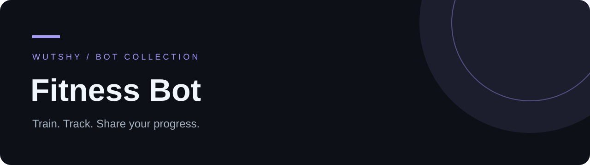

<div align="center">

   

**A Telegram workout tracker with personal programs and a community workshop.**

[English](README.md) · [Русский](README.ru.md) · [Detailed guide / Подробное руководство](GUIDE.ru.md)

[](https://t.me/TrenirovkaWSBot)

</div>

## Highlights

- Guided workout sessions with sets, weight, reps, RIR and rest controls.
- Training history, personal records, measurements, goals and achievements.
- Personal program library, editable copies and explicit workshop publishing.
- Friends, challenges and shared workout rooms; an Excel-derived starter program.

## Quick start

```bash
git clone https://github.com/wuttashi1/fitness-bot-mvp.git
cd fitness-bot-mvp
python -m venv .venv
source .venv/bin/activate
python -m pip install -r requirements.lock
python -m pip install --no-deps -e .
cp .env.example .env
# Set BOT_TOKEN and OWNER_TELEGRAM_ID in .env.
python -m fitness_bot
```

On Windows, activate with `.venv\Scripts\Activate.ps1` and copy with `Copy-Item .env.example .env`. To find your numeric Telegram ID, configure the token, run `python -m fitness_bot --identify`, send `/id` to your bot, then stop this mode and set `OWNER_TELEGRAM_ID`. The bot interface is in Russian. Shared rooms track participants and sessions; synchronized timers are not implemented.

## Development checks

```bash
python -m pip install -e ".[dev]"
python -m pytest -q
```

## Project map

`fitness_bot/bot.py` · Telegram UI | `service.py` · domain | `db.py` · SQLite | `data/` · starter program | `tests/` · checks

## Documentation

- [ Full operating guide: configuration, workflows and limitations (Russian) ](GUIDE.ru.md)
- [Docker / CasaOS deployment (RU)](CASAOS.md)

Keep credentials in your local `.env`. Runtime databases and backups are excluded from version control.
