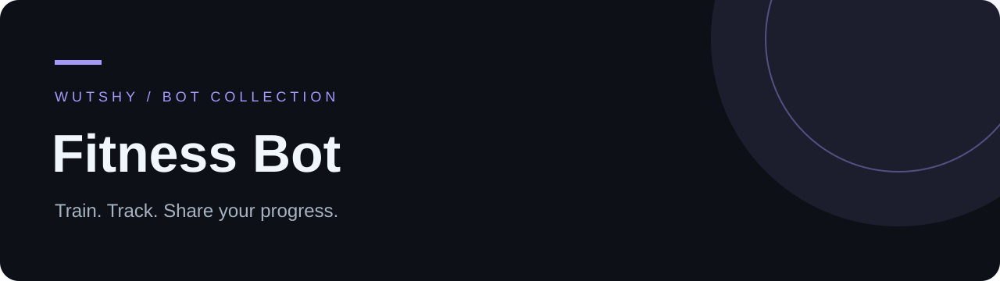

<div align="center">

   

**Telegram-дневник тренировок с личными программами и каталогом WORK SHOP.**

[English](README.md) · [Русский](README.ru.md) · [Detailed guide / Подробное руководство](GUIDE.ru.md)

[](https://t.me/TrenirovkaWSBot)

</div>

## Возможности

- Тренировки с учётом подходов, веса, повторов, RIR и отдыха.
- История занятий, рекорды, замеры, цели и достижения.
- Библиотека программ, редактируемые копии и публикации в WORK SHOP.
- Друзья, челленджи, комнаты тренировок и стартовая программа из Excel.

## Быстрый запуск

```bash
git clone https://github.com/wuttashi1/fitness-bot-mvp.git
cd fitness-bot-mvp
python -m venv .venv
source .venv/bin/activate
python -m pip install -r requirements.lock
python -m pip install --no-deps -e .
cp .env.example .env
# Set BOT_TOKEN and OWNER_TELEGRAM_ID in .env.
python -m fitness_bot
```

В Windows активируйте окружение через `.venv\Scripts\Activate.ps1`, скопируйте настройки командой `Copy-Item .env.example .env`. Укажите токен и свой числовой `OWNER_TELEGRAM_ID`. Узнать ID: `python -m fitness_bot --identify`, затем `/id` в боте; после этого остановите режим определения. Интерфейс — на русском. Общие комнаты показывают участников и сессии, синхронных таймеров пока нет.

## Проверка проекта

```bash
python -m pip install -e ".[dev]"
python -m pytest -q
```

## Структура

`fitness_bot/bot.py` · Telegram UI | `service.py` · domain | `db.py` · SQLite | `data/` · starter program | `tests/` · checks

## Документация

- [ Полное руководство: настройка, работа и ограничения ](GUIDE.ru.md)
- [Docker / CasaOS deployment (RU)](CASAOS.md)

Токен храните только в локальном `.env`. Базы данных и резервные копии не предназначены для публикации.
